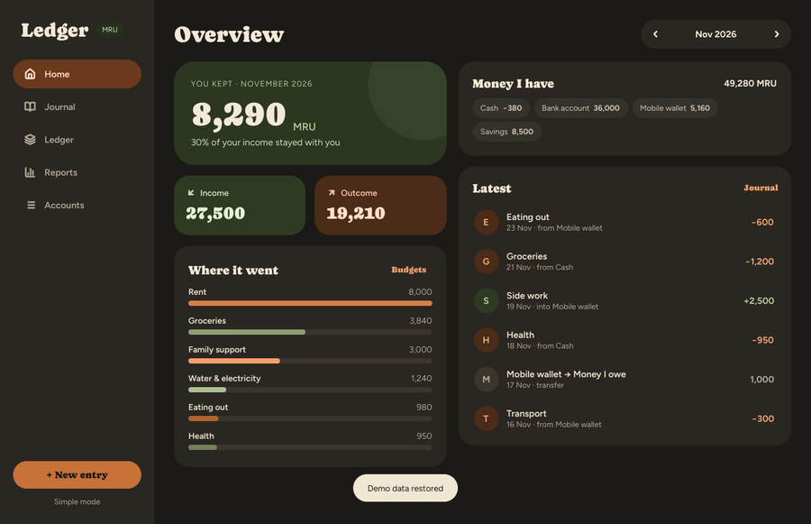
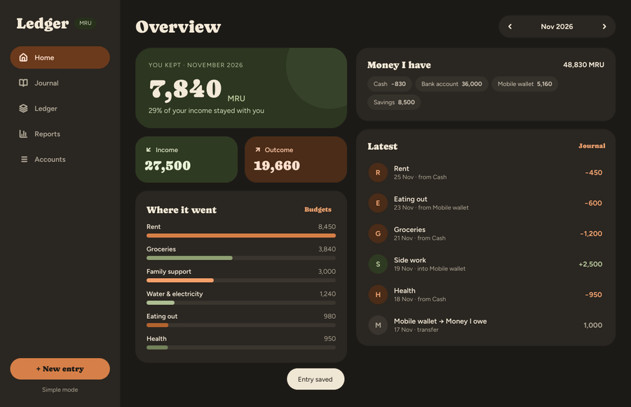

# Ledger MRU — Rust

[](https://github.com/XERELE-MDK/ledger-mru-rust/actions/workflows/ci.yml)
[](https://github.com/XERELE-MDK/ledger-mru-rust/releases/latest)
[](LICENSE)

**Personal bookkeeping in Mauritanian ouguiya (MRU), for Linux**, written in **Rust + [Slint](https://slint.dev)**. Real double-entry accounting behind a Simple mode, in a window that opens in a quarter of a second and uses about 21 MiB of memory.

No account, no server. Your book is one JSON file, shared with the Android and Flutter versions.

<p>
  
  
  
  
</p>

## Download

[**Latest release**](https://github.com/XERELE-MDK/ledger-mru-rust/releases/latest) — x86_64:

| Distribution | File | Install |
|---|---|---|
| Arch, Manjaro | `.pkg.tar.zst` | `sudo pacman -U ledger-mru-*.pkg.tar.zst` |
| Debian 12+, Ubuntu 22.04+ | `.deb` | `sudo apt install ./ledger-mru_*.deb` |
| Fedora 35+, openSUSE | `.rpm` | `sudo dnf install ./ledger-mru-*.rpm` |
| any, no root | `.tar.gz` | `tar xf ledger-mru-*.tar.gz` then `./install.sh` |

Needs glibc 2.34 or newer. Check a download: `sha256sum -c SHA256SUMS --ignore-missing`. Your data lives in `~/.local/share/ledger-mru/` and survives uninstalling.

## Why a Rust version?

Same book, same rules, a much lighter engine. Measured on the same machine with [`tools/bench_desktop.py`](tools/bench_desktop.py):

| | Flutter Linux | **Rust + Slint** |
|---|---|---|
| Window shown after | 894 ms | **272 ms** |
| Memory (PSS) | 136 MiB | **21 MiB** |
| Private dirty memory | 60 MiB | **4.5 MiB** |

Pick the [Flutter version](https://github.com/XERELE-MDK/ledger-mru-flutter) if you want the same app as on the phone, with 6 themes and 3 languages.

| | Rust | Flutter |
|---|---|---|
| Languages | English | English, French, Japanese |
| Themes | Organic light / dark (follows the system) | 6 themes, each with its own fonts |
| Home screens | 1 | 4 |
| Sync, import / export, opening balances, budgets | ✅ | ✅ |

## Two-minute tour

1. **First launch**: three months of demo data.
2. **Start for real**: *Start with an empty book* removes the demo, and only the demo.
3. **Opening balances**: *Accounts → Opening balances* — what you have and owe today.
4. **+ New entry**: Expense, Income or Transfer (Simple), or pick both accounts (Accountant). A preview shows the debit and credit before saving.
5. **Read your month**: Home, Journal, Ledger, Reports.
6. **Sync** (optional): *Accounts → Sync*, point at a folder shared by [Syncthing](https://syncthing.net), **Connect**.

## Features

| | |
|---|---|
| 🧮 [Accounting core](docs/accounting-core/FUNCTIONALITY.md) | Double entry, the five account types, amount parsing |
| ✍️ [Adding an entry](docs/entry/FUNCTIONALITY.md) | Simple or Accountant mode, with a preview and Undo |
| 🖥️ [Screens](docs/screens/FUNCTIONALITY.md) | Home, Journal, Ledger, Reports (trial balance, 6 months, budgets) |
| 🗂️ [Accounts and budgets](docs/accounts-and-budgets/FUNCTIONALITY.md) | Create, edit, delete; monthly budget |
| 🏁 [Opening balances](docs/opening-balances/FUNCTIONALITY.md) | Your starting point as one balanced entry |
| 🧪 [Empty book and demo](docs/empty-book-and-demo/FUNCTIONALITY.md) | Try it, then start clean |
| 🌓 [Appearance](docs/appearance/FUNCTIONALITY.md) | System, Light or Dark |
| 📤 [Import and export](docs/import-export/FUNCTIONALITY.md) | One JSON file shared by all three versions |
| 🔄 [Sync](docs/sync/FUNCTIONALITY.md) | Across devices through a shared folder, no server |
| 🛟 [Data safety](docs/data-safety/FUNCTIONALITY.md) | Atomic writes; a bad file is set aside, never overwritten |
| 📸 [Screenshot scenario](docs/screenshots/FUNCTIONALITY.md) | The whole UI played without a window — also an end-to-end test |
| 📦 [Linux packages](docs/linux-packages/FUNCTIONALITY.md) | How the four packages are built |

## The Ledger MRU family

| Repository | What | For |
|---|---|---|
| [ledger-mru-rust](https://github.com/XERELE-MDK/ledger-mru-rust) (here) | Rust + Slint | Linux PC, lightweight |
| [ledger-mru-flutter](https://github.com/XERELE-MDK/ledger-mru-flutter) | Dart: screens, logic, tests, Linux build | Linux PC, same app as the phone |
| [ledger-mru-mobile](https://github.com/XERELE-MDK/ledger-mru-mobile) | Android project | phone |

All three read and write **the same JSON file** and sync through a shared folder. The Rust and Dart logics are checked against the same test cases (`CONTRACT.sha256`).

## Build from source

Rust **1.96** or newer (edition 2024) and the `fontconfig` headers.

```bash
git clone https://github.com/XERELE-MDK/ledger-mru-rust.git
cd ledger-mru-rust
cargo test
cargo run --release -p ledger-desktop
```

| Folder | Role |
|---|---|
| `ledger-core/` | UI-free core: model, calculations, JSON, merge, shared folder |
| `ledger-desktop/` | Slint UI (`ui/`) and the Rust shell (`src/main.rs`) |
| `packaging/` | Arch, Debian, RPM and rootless archive |
| `tools/` | release notes, desktop benchmark |

## Documentation

[**docs/**](docs/README.md) — one folder per feature: what it does, how it is coded. Also: [Changelog](CHANGELOG.md) · [Versioning](docs/VERSIONING.md).

## Licence

[GPL-3.0](LICENSE). Fonts: SIL OFL 1.1, see [LICENSES.md](ledger-desktop/ui/fonts/LICENSES.md).
