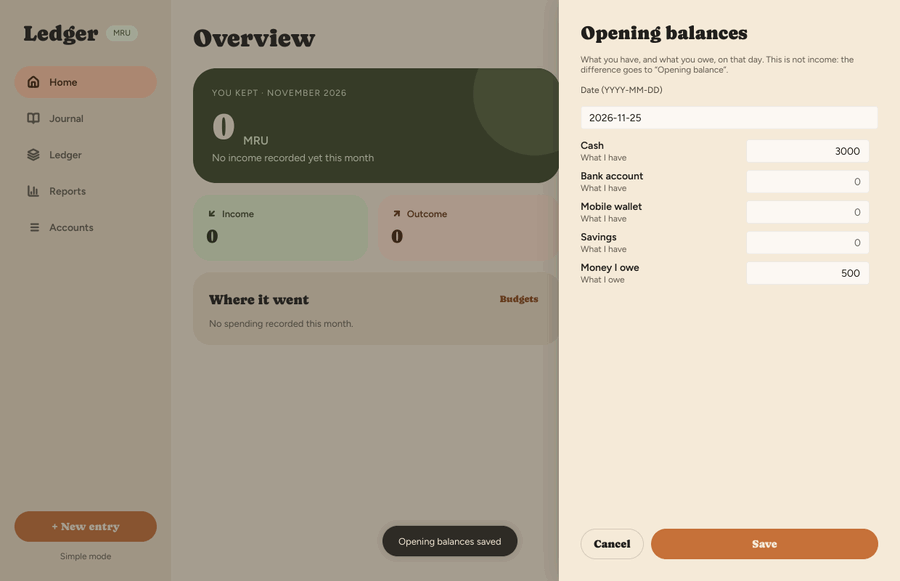
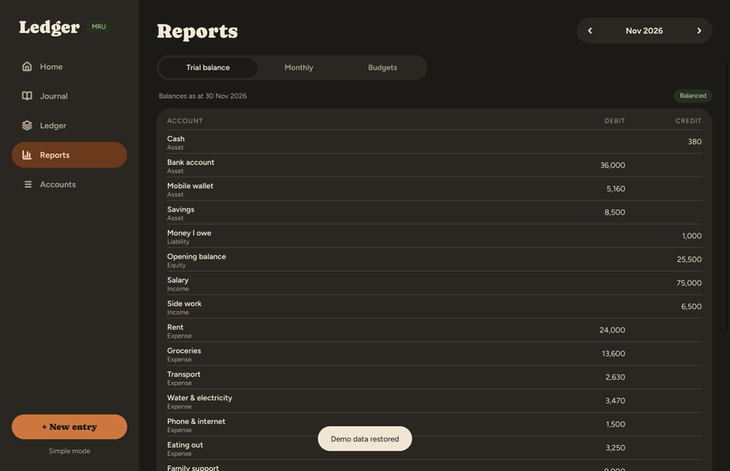

# Ledger MRU — Rust

[](https://github.com/XERELE-MDK/ledger-mru-rust/actions/workflows/ci.yml)

Comptabilité personnelle en ouguiya (MRU) pour Linux, en **Rust + [Slint](https://slint.dev)** : une vraie partie double, cachée derrière un mode Simple.

| Dépôt | Contenu | Pour |
|---|---|---|
| [ledger-mru-rust](https://github.com/XERELE-MDK/ledger-mru-rust) | Rust + Slint | PC Linux, léger (~25 Mio de mémoire) |
| [ledger-mru-flutter](https://github.com/XERELE-MDK/ledger-mru-flutter) | Dart : écrans, logique, tests, version Linux | PC Linux, même app que le téléphone |
| [ledger-mru-mobile](https://github.com/XERELE-MDK/ledger-mru-mobile) | projet Android | téléphone |

Les trois lisent et écrivent **le même fichier JSON** et se synchronisent par un dossier partagé, sans serveur.

<p>
  
  
  
  
</p>

## Fonctionnalités

Chaque fonctionnalité a son dossier dans [**docs/**](docs/README.md) : ce qu'elle fait, et comment elle est codée.

[Noyau comptable](docs/noyau-comptable/FUNCTIONALITY.md) · [Saisie](docs/saisie/FUNCTIONALITY.md) · [Écrans](docs/ecrans/FUNCTIONALITY.md) · [Comptes et budgets](docs/comptes-et-budgets/FUNCTIONALITY.md) · [Soldes de départ](docs/soldes-de-depart/FUNCTIONALITY.md) · [Livre vide](docs/livre-vide-et-demo/FUNCTIONALITY.md) · [Apparence](docs/apparence/FUNCTIONALITY.md) · [Import / export](docs/import-export/FUNCTIONALITY.md) · [Synchronisation](docs/synchronisation/FUNCTIONALITY.md) · [Protection des données](docs/protection-des-donnees/FUNCTIONALITY.md) · [Captures](docs/captures/FUNCTIONALITY.md) · [Paquets Linux](docs/paquets-linux/FUNCTIONALITY.md)

Versions : [journal](CHANGELOG.md) · [comment elles sont gérées](docs/VERSIONING.md).

## Démarrer

Rust **1.96** ou plus récent (édition 2024), et les en-têtes de `fontconfig`.

```bash
git clone https://github.com/XERELE-MDK/ledger-mru-rust.git
cd ledger-mru-rust
cargo test
cargo run --release -p ledger-desktop
```

Paquets prêts à installer : [Releases](https://github.com/XERELE-MDK/ledger-mru-rust/releases).

## Organisation

| Dossier | Rôle |
|---|---|
| `ledger-core/` | noyau sans interface : modèle, calculs, JSON, fusion, dossier partagé |
| `ledger-desktop/` | interface Slint et coquille Rust |
| `packaging/` | paquets Arch, Debian, RPM et archive sans root |

## Licence

[GPL-3.0](LICENSE). Polices : SIL OFL 1.1, voir [LICENSES.md](ledger-desktop/ui/fonts/LICENSES.md).
