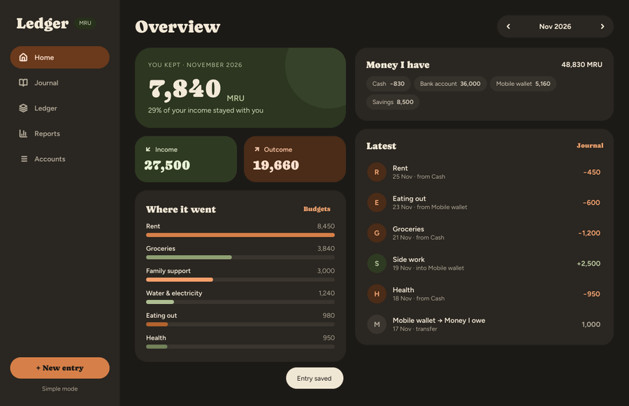

# Appearance — how it works

[← All features](../README.md) · [Code walkthrough](CODE_WALKTHROUGH.md)

*Accounts → Appearance*: System, Light or Dark. The choice is saved in the book.

| Theme | Colours | Fonts |
|---|---|---|
| **Organic light** | cream `#F5EAD8`, terracotta `#C67139`, olive `#7A8A5E` | Caprasimo + Figtree, bundled |
| **Organic dark** | deep brown `#1C1A17`, same accents | Caprasimo + Figtree, bundled |

The Rust version has these two themes and English only. The six themes and three languages are in the [Flutter version](https://github.com/XERELE-MDK/ledger-mru-flutter).

