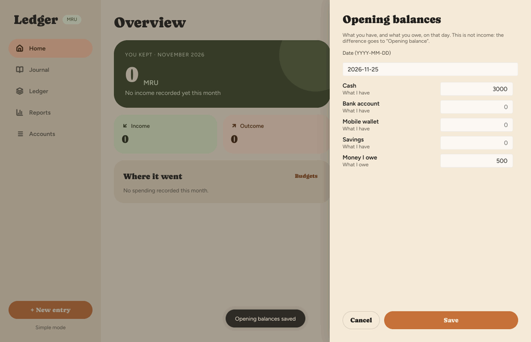

# Opening balances — how it works

[← All features](../README.md) · [Code walkthrough](CODE_WALKTHROUGH.md)

*Since 1.2.0.*

One amount per asset and liability account, at a given date. The app turns them into **a single balanced entry**; the difference goes to equity. It is **not income**.

- From the home screen of an empty book, or *Accounts → Opening balances*.
- Reopening the screen shows the balances; changing them replaces the entry; clearing everything removes it.
- Your own equity entries are never touched.
