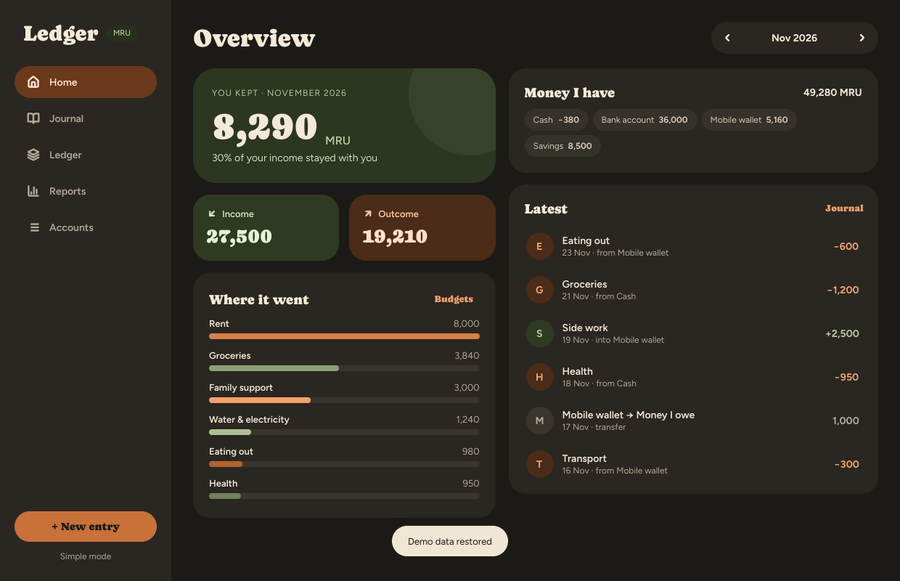
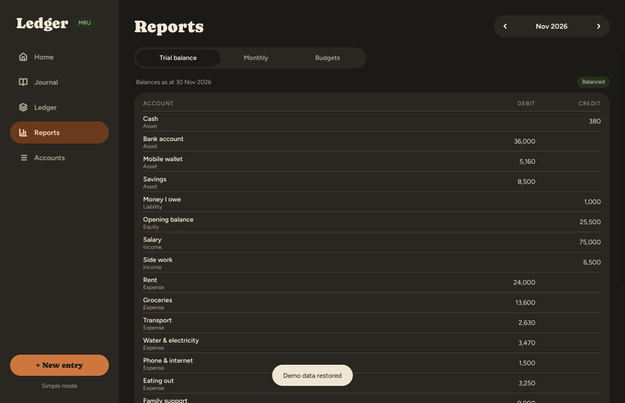

# Screens — how it works

[← All features](../README.md) · [Code walkthrough](CODE_WALKTHROUGH.md)

| Screen | Content |
|---|---|
| Home | what is left of the month, categories, holdings, latest entries |
| Journal | the month's entries by day; debits / credits in Accountant mode |
| Ledger | one account: opening, movements, running balance, closing |
| Reports | trial balance, 6 months, budgets |

  
  

